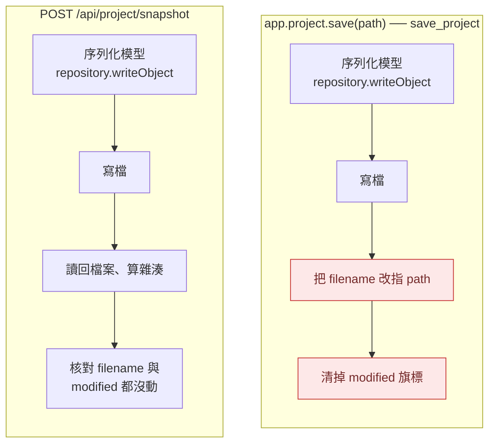

# 非破壞性模型快照端點：POST /api/project/snapshot

出處見附錄 A。

## 一、這支端點做什麼

它把 StarUML 記憶體裡的模型寫成一個獨立的 `.mdj` 檔，然後回報寫出了多少位元、雜湊是多少，而開啟中的專案完全不動。

```
POST /api/project/snapshot
  { "path": "<你要寫到的絕對路徑，副檔名 .mdj>" }

→ { "success": true,
    "data": {
      "path": "<你給的路徑，正規化後>",
      "bytes": 11412541,
      "sha256": "1c6e6cb7…b02c",
      "projectFilename": "<不變，仍是原本開啟的那個檔>",
      "modified": false
    } }
```

任何一步沒做到就回 `success: false` 並說明原因，不會回 success 配一個空欄位。寫檔失敗、雜湊算不出來、寫出來的位元與序列化的結果不符、`filename` 或 `modified` 在呼叫期間動了——這五種情況都判失敗。

## 二、它跟 save_project 差在哪

`app.project.save()` 做四件事，只有前兩件屬於快照。後兩件就是「另存新檔」的來源：存檔之後，開啟中的專案已經是新路徑，你原本那個檔從此收不到任何變更，而且沒有任何錯誤訊息。多個工作階段共用同一個 StarUML 實例時，這個分歧特別難發現。



紅色那兩步是資料分歧的來源，快照完全不走它們。它不呼叫 `app.project.save()`，而是直接呼叫 `app.repository.writeObject()` 再自己寫檔。這樣安全，因為 `writeObject()` 只建一個 Writer、呼叫 `elem.save(writer)`、回傳 `JSON.stringify` 的結果，它不指派任何東西、也不發任何事件。

它也不用「先存到新路徑、再存回原路徑」那種做法，所以沒有中途 `filename` 指錯的空窗。

還有一道守門：`path` 指到開啟中專案自己的檔案時，端點直接拒絕。否則快照就變成一次存檔，而那正是它唯一不能做的事。這道比對會跟著 symlink 走，所以一個名字看起來無關、實際指向專案檔的連結也擋得住。

回應裡的 `path` 是正規化後的絕對路徑，也就是位元真正寫進去的那個檔，不是原封回傳你送來的字串。

## 三、實測到的行為與數字

在真的 StarUML 上、載入 `/Users/wuufone/Desktop/dev/vu/YC_POS_SYS/spec/佑全新POS_領域模型與架構.mdj`（11.4 MB）量到的。腳本是 `test/verify_snapshot_live.py`，可以重跑，它會把改過的名字改回去。

下表把呼叫前的 `project.filename` 記為 A，把磁碟原檔的 sha256 記為 B。這一次量到的 B 是 `1c6e6cb7…b02c`，檔案 11,412,541 bytes。這些絕對數值會隨專案每次存檔而變，腳本每跑一次都會重新印出來，重點是欄與欄之間的相等或不等關係。

| 行為 | 實測結果 |
|---|---|
| 快照寫得出完整模型 | HTTP 200、`success: true`，寫出 11,412,531 bytes，sha256 `4e735a36…e146` |
| 呼叫前後 `filename` 不變 | 前後同一字串，逐字元相同 |
| 回應的雜湊等於磁碟上的檔案 | 回應 11,412,531 / `4e735a36…e146`，磁碟 11,412,531 / `4e735a36…e146` |
| 快照不碰原檔 | 原檔仍是 B |
| 它匯出的是記憶體，不是複製磁碟檔 | 改掉一個元素的 name 後再快照 → 11,412,545 bytes / `c986184d…c6ac`，與 B 不同 |
| 改完 name 之後 `filename` 仍不變 | 前後同一字串 |
| 往返沒有掉元素、沒有掉參照 | 磁碟與快照都是 17,794 個 `_id`、17,794 個 `_type`、**47,499 個 `$ref`** |
| 記憶體的差異精確反映在快照裡 | 改名前後兩份快照只差 2 行，就是那個 name |
| 改名再改回，序列化結果位元相同 | 兩次都是 `4e735a36…e146` |
| symlink 指向開啟中的專案檔 | 被拒絕，原檔雜湊不變 |
| `data.path` 是正規化後、位元真正寫進去的那個路徑 | 送 `…/sub9h/../snap9h.mdj`，回報 `…/snap9h.mdj`，且檔案在該處 |

路徑錯誤的逐字回應：

| 情況 | 回應 |
|---|---|
| 目錄不存在 | `Directory does not exist: "…/no-such-dir-9a". Create it first, or pass a path inside an existing directory.` |
| 目錄不可寫 | `Directory is not writable: "…/readonly-9b"`，且不產生任何檔案 |
| 相對路徑 | `Field "path" must be an absolute path (e.g. "/Users/.../snapshot.mdj")` |
| `path` 是開啟中的專案檔 | `Field "path" must not be the open project file ("…"). A snapshot writes a separate copy. Use POST /api/project/save to write the project itself.`，且原檔仍為 B |
| 副檔名不是 `.mdj` | `Field "path" must have .mdj extension (e.g. "/Users/.../snapshot.mdj")` |
| 帶未知欄位 | `Unknown field(s): bogus. Allowed fields: path` |

六種都回 `success: false`，沒有任何一種靜默成功。

## 四、雜湊比對回答不了「有沒有人未存檔」

這支端點是為了回答「有沒有別人未存檔的工作會被我的存檔蓋掉」而做的。**但只比雜湊會誤判，而原因不在這支端點。**

專案剛從磁碟載入、什麼都沒改，快照就與原檔差 10 bytes。差異整整只有三個數字，在同一張圖的兩個 `LabelView` 上，而且這三個數字在不同次執行之間會在兩組值之間來回：

| 欄位 | 一組值 | 另一組值 |
|---|---|---|
| `left` | 34.6025390625 | 33.1829833984375 |
| `width` | 137.8076171875 | 123.49996948242188 |
| `width` | 15.6025390625 | 14.1829833984375 |

StarUML 載入圖的時候會重新量測標籤文字，字型度量只要有一點差別，量出來的寬度就不一樣。這與快照無關：`writeObject` 是純函式，而且同一個模型連續快照兩次雜湊完全相同。模型內容不受影響，元素數與參照數兩組值都一樣。

這件事還有一個副作用值得知道：只要載入過就會讓 `modified` 變成 `true`，所以關閉 StarUML 時它會問要不要存檔，存下去就把重新量測的值寫進 `.mdj`。檔案因此會變動，但變動的永遠只有這三個數字。

**所以雜湊相同一定代表沒有未存檔的工作，雜湊不同卻不代表有。** 光是重開一次 StarUML 就會製造出不同的雜湊。

比較可靠的答案是回應裡的 `modified`。它是 StarUML 自己的記錄，直接回答「這個模型從載入或存檔之後有沒有被改過」。建議的判斷順序是先看 `modified`，`false` 就是沒有未存檔的工作。要進一步知道記憶體裡究竟是什麼，再用 `sha256` 比對。

## 五、兩件與直覺相反的現況

**StarUML 有 dirty 旗標。** `Repository.isModified()` 是公開方法，`save()` 與 `load()` 都靠 `setModified(false)` 去清它。`GET /api/status` 不回報它，所以從 HTTP 這一側看起來像沒有。`POST /api/project/snapshot` 的回應會回報它。

**`POST /api/project/export` 餵進專案根元素，本來就能非破壞性地匯出全模型。** 把 `elementId` 給成根元素 `AAAAAAFFxl2a6D9NCaE=`，它匯出的就是整個模型：11,412,531 bytes、sha256 `4e735a36…e146`，與磁碟檔位元相同，前後 `project.filename` 不變。原因是 `exportToFile()` 也只做 `writeObject` 加寫檔，同樣不碰 `filename`。

那條路仍然比不上快照端點，因為 `export` 不回報位元數與雜湊、要先知道根元素的 id、而且會發出 `exported` 事件。但要在只有舊版 controller 的機器上做同一件事，它是可行的替代做法。

## 六、MCP 工具 project_snapshot

工具名 `project_snapshot`，宣告在 `../staruml-mcp-servers/staruml-controller-mcp-core/src/tools/project.ts` 的 `projectTools`，與 `project_export`、`project_export_all` 同一組。`createServer()` 會把 `projectTools` 併進每一個伺服器，所以 25 個 MCP 伺服器都有這支工具。core 是用 `file:` 依賴以 symlink 連進各伺服器的 `node_modules`，因此建置 core 一次就全部吃到，不必逐一 `npm install`。

建置後的 `dist` 宣告如下：

```
name         : project_snapshot
method/path  : POST /api/project/snapshot
input keys   : [ 'path' ]
empty rejected: true
```

⚠ **要重啟 MCP 客戶端才會看到這支工具。** MCP 伺服器的行程只在啟動時讀工具宣告，而客戶端是 `additionalProperties: false`，未宣告的參數會在客戶端就被擋掉。HTTP 那一側不受影響，隨時可以直接用 curl 呼叫。

⚠ **`staruml-mcp-servers` 那個目錄沒有 git 版控**，所以那邊的改動沒有版本可以回溯。要移除這支工具，就把 `../staruml-mcp-servers/staruml-controller-mcp-core/src/tools/project.ts` 裡 `project_snapshot` 那一段刪掉，再在 `staruml-controller-mcp-core` 目錄下跑一次 `npm run build`。

## 七、改動這個擴充套件之後要怎麼讓它生效

`~/Library/Application Support/StarUML/extensions/user/staruml-controller` 是指回本 repo 的 symlink，所以改本 repo 的檔就是改 StarUML 會載入的程式。但 StarUML 要重新啟動才會重新讀進來，而且**伺服器不會自動啟動**：重啟之後要走 Tools → StarUML Controller → Start Server…，並確認埠號（預設 12345）。

`test/test_all_endpoints.sh` 會在開跑前用這支端點做一份還原用的副本，所以它需要含這支端點的版本。跑在舊版上它會明確說出缺少這支端點並停住，不會默默把你的專案改指到 /tmp。

判斷跑起來的是哪一份程式，不要看 `GET /api/status` 的 `version`——那個值來自 `package.json`，不隨改動變化。要用能力探測：`POST /api/project/snapshot` 回 `Not found` 就是舊版，回 `Field "path" is required` 就是含這支端點的版本。

---

## 附錄 A、資訊來源

全部是第一手來源。StarUML 引擎那幾份是從 `/Applications/StarUML.app/Contents/Resources/app.asar` 抽出來的，asar 檔頭自行解析，未經第三方工具。

| 來源 | 支持本文的哪一段 |
|---|---|
| app.asar 內 `src/engine/project-manager.js` 第 126–145 行（`save()`） | 第二節那張圖的四個步驟：`writeObject` → `writeFileSync` → `this.filename = fullPath` → `setModified(false)` → 發 `projectSaved` |
| 同檔第 291–308 行（`exportToFile()`）、第 152–175 行（`load()`）、第 60 行（`getFilename()`） | 第五節第二條：`export` 也只做序列化加寫檔，不碰 `filename` |
| app.asar 內 `src/core/repository.js` 第 1583 行（`writeObject()`） | 第二節「它是純函式」：`new Writer()` → `elem.save(writer)` → `JSON.stringify(writer.current, null, "\t")` |
| 同檔第 2066 行（`isModified()`）、第 2075 行（`setModified()`） | 第五節第一條：dirty 旗標存在 |
| `test/verify_snapshot_live.py` 的完整輸出，19 項全過 | 第三節兩張表的每一個數字 |
| 磁碟原檔與快照的逐行 diff | 第四節那三個標籤數字 |
| `POST /api/project/export` 餵根元素的探測回應 | 第五節第二條的位元數與雜湊 |
| `PUT /api/elements/__nonexistent__` 的回應：`Unknown field(s): __probe__. Allowed fields: name, stereotype, documentation, referenceId, typeId, typeName, type, direction, specification, constrainedElementIds` | 欄位白名單的檢查發生在 `findById` 之前，所以可以用不存在的 id 唯讀探測 |
| 建置後 core 的工具宣告 | 第六節那段輸出 |
| `main.js` 第 11 行、第 34–133 行 | 第七節：預設埠號 12345，伺服器由選單命令啟動 |
| `menus/menu.json` | 第七節：Tools → StarUML Controller → Start Server… |
| `test/run_integration_safely.sh` 第 54–56 行 | 第七節：明文寫「不要用 `/api/status` 的 version 當 build 標記」 |

## 附錄 B、待確認

- 第四節那 10 bytes 的標籤幾何漂移，**確切成因未查證**。已查證的是它只影響 3 個數字、只在載入時發生一次、同一次執行內連續快照之間穩定、在不同次執行之間於兩組值來回，而且與快照端點無關。字型度量為什麼會這樣擺盪，沒有查。
- 「`save` 與 `snapshot` 對同一個模型會寫出相同位元」這一條是**推論**，依據是兩者都呼叫 `writeObject(project)`（app.asar 內 `src/engine/project-manager.js` 第 127 行）。沒有實測，因為實測要對這個專案存檔一次，而任務明文不准動 `save_project`、也不該改使用者的檔案。
