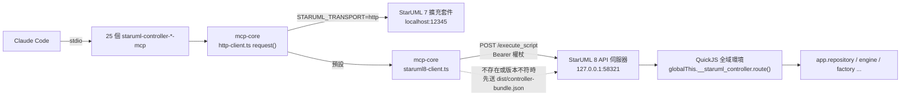

# StarUML 8 遷移評估：讓 25 個 MCP 改接內建 API 伺服器

評估日期：2026-11-20。環境：StarUML 8.1.0 (macOS arm64)。

## 結論

- 這條路可行，傳輸層已經實作在 `staruml-controller-mcp-core`（見「傳輸層」一節）。
- 25 個 MCP 不必各自修改。它們都透過符號連結使用同一份 `staruml-controller-mcp-core`，自己沒有發 HTTP 請求的程式碼。所有請求都經過 `mcp-core/src/http-client.ts` 的 `request()`，只要換掉這一個傳輸層。
- 現有的路由程式碼（`api-handler.js`、`ddl-generator.js`、`handlers/*`）可以整包打包 (bundle) 成一段腳本，送進 StarUML 8 執行，不必重寫。
- 在空白專案上透過暫時代理跑 `test/test_all_endpoints.sh`，428 個案例通過 416 個。失敗的 12 個全都屬於「檔案」與「指令」類。
- StarUML 8 的腳本不能讀寫檔案。存檔（存回原檔）、快照、匯出片段已改由 StarUML 指令或 MCP 端（Node）處理，並實測通過。開檔、匯入、圖片匯出、全部匯出、DDL 仍然失敗。
- `POST /api/validate` 與 Markdown 匯出在 StarUML 8 找不到對應的功能。
- 只檢查 `success: true` 會漏掉一類問題：StarUML 8 讀 view 的 `points` 時，拿到的是沒有方法的複本。這讓邊線標籤定位失效，也讓修改邊線點座標的寫法默默失效。`test/verify_gaps_live.py` 的語意檢查抓到了這個問題。
- 上游 `pontasan/staruml-controller` 最新的 2.0.0 版（2026-09-21）同樣在 `main.js` 載入 `http`、`crypto`、`electron`，也不支援 StarUML 8。

## StarUML 8 的 API 伺服器

官方的 `staruml-mcp-server` 0.3.0 是第一手參考實作。下表的端點與授權流程都取自它的 `src/utils.ts` 與 `src/index.ts`。

| 項目 | 內容 |
|---|---|
| 位址 | `http://127.0.0.1:58321`。只聽 IPv4 迴路位址。預設值可在 Preferences > API Server 修改。 |
| 申請權杖 | `POST /request_api_token`，本文為 `{"appName": "<名稱>"}`。StarUML 會跳出對話框，使用者按 Allow 後回傳權杖。 |
| 權杖效期 | StarUML 重新啟動後失效。這時 API 回 401，用戶端要重新申請。 |
| 呼叫方式 | 全部用 `POST`，帶 `Authorization: Bearer <權杖>` 與 `Content-Type: application/json`。 |
| 回應格式 | `{"success": true/false, "data": ..., "error": ...}` |
| `/execute_script` | 本文 `{"code": "<JavaScript>"}`。回傳 `{result, error, output}`。`result` 是最後一個運算式在 Script Console 的顯示文字。 |
| 其他端點 | `/generate_diagram`、`/get_all_diagrams_info`、`/get_current_diagram_info`、`/get_diagram_image_by_id`（回傳 base64 PNG）。 |

`execute_script` 跟 Script Console 用同一個執行環境 (QuickJS)，限制如下：

- 不能用 `require()`、計時器、Node.js API 與檔案存取。
- 單一腳本執行超過 30 秒會被中斷。
- 所有腳本共用同一個全域環境，全域變數會保留到下一次呼叫。

## 傳輸層

路由程式碼採「由 MCP 端注入」的做法：

- `npm run build` 執行 `scripts/build-controller-bundle.mjs`，把 `staruml-controller/` 的根目錄 `.js`（`main.js` 除外）、`handlers/*.js` 與 `package.json` 打包成 `dist/controller-bundle.json`。打包檔帶著原始碼的雜湊值當版本號。
- StarUML 不必安裝 controller 擴充套件。StarUML 重新啟動後，下一次工具呼叫會自動重新注入。
- 代價：改了 controller 的程式碼之後，要重新建置 `mcp-core`，打包檔才會更新。

`staruml8-client.ts` 每次呼叫做這些事，接手原本 `main.js` 的工作：

1. 把 `body.text` 與 `body.documentation` 裡的字面 `\n`、`\t` 轉成換行與定位字元。
2. 送一段腳本呼叫 `globalThis.__staruml_controller.route(method, url, body)`，在 `try`/`catch` 裡執行，把結果用 `JSON.stringify` 包好再傳回。
3. 如果全域名稱不存在或版本不符，先送打包檔，再重試第 2 步。
4. 依回應換算成原本的 HTTP 狀態碼：成功是 200，錯誤訊息符合 `not found: ` 是 404，其他錯誤是 400，路由丟出例外是 500。這樣 `response-formatter.ts` 不必修改。

預設主機是 `127.0.0.1`，預設連接埠是 58321。官方 MCP 的註解寫，`localhost` 可能解析成 IPv6 的 `::1`。

驗證結果：

| 測試 | 結果 |
|---|---|
| `npm test`（離線，假的 API 伺服器搭配 controller 的 `mock-staruml.js`） | 13 項全過。涵蓋權杖申請、StarUML 重新啟動後恢復、版本不符時重新注入、狀態碼對照、拒絕存取、連不上、5 個行程同時申請權杖只跳一次對話框 |
| `node test/live-staruml8.mjs`（實機，空白專案） | 11 項全過。經由 class MCP 建圖、建兩個類別、建關聯、改名、改說明、讀回、刪除。首次呼叫含對話框約 2 秒，之後每次約 30 毫秒 |
| erd、seq、usecase 三個 MCP 的 `diagram_list` | 都直接用共用權杖，沒有再跳對話框 |

## 實機驗證結果

驗證只跑唯讀操作，對象是使用者當時開著的專案（479 張圖）。驗證程式放在暫存區，沒有修改本專案或 `mcp-core`。

| 項目 | 結果 |
|---|---|
| 打包程式碼 | 用一個模組對照表把 29 個模組（根目錄 3 個檔案加 `handlers/` 的 26 個檔案）包成一段 555 KB 的腳本。Node 內建模組換成「載入成功、呼叫時才丟例外」的替身。 |
| 離線載入 | 在 Node 搭配 `test/mock-staruml.js` 載入成功，`GET /api/status` 與 `GET /api/diagrams` 正常回應。 |
| 實機注入 | 0.22 秒完成。 |
| `GET /api/status` | 成功，0.03 秒。 |
| `GET /api/diagrams` | 成功，回傳 479 張圖、67 KB，0.14 秒。 |
| `GET /api/diagrams/:id/elements`、`/views` | 成功，各 0.03 秒。 |
| `GET /api/elements/:id` | 成功，0.03 秒。 |
| 回傳通道 | 約 200 萬字元的字串原樣傳回，內容包含換行、引號、反斜線、U+2028、表情符號、中文與 NUL 字元。`console.log` 的通道也能原樣傳回。 |
| 大型腳本 | 3 MB 的腳本可以送進去，耗時 1.1 秒。 |
| 全域變數 | 第一次呼叫設的值，第二次呼叫讀得到。 |
| `constructor.name`、`instanceof type.X` | 跟 StarUML 7 一樣可用。 |
| Promise | 不會被等待。回傳 Promise 時，`result` 只是 `Promise {}`。 |

驗證限制：

- 注入前，專案的 `isModified()` 與 `canUndo()` 本來就都是 `true`，所以前後比對只是弱證據。
- 「沒有動到模型」的主要依據是程式碼檢查。從上表 5 支路由的處理函式出發，沿呼叫鏈走過 `api-handler.js`、`shared-helpers.js`、`crud-factory.js`、`edge-routing.js` 裡的 28 個函式，沒有任何一個呼叫 `app.engine`、`app.factory`、`app.selections`、`app.commands.execute`，也沒有切換或重畫圖表。這項檢查只涵蓋 `function 名稱()` 形式宣告的函式。
- 驗證結束後已刪除注入的路由程式碼。探測時有 5 個用 `var` 宣告的全域名稱（`c`、`e`、`d`、`s`、`big`）刪不掉，值已改成 `undefined`，StarUML 重新啟動後會消失。

## API 相容性

程式碼用到 88 個 `app.*` 與 `type.*` 名稱，其中 80 個在 StarUML 8 存在。不存在的 8 個是：

- `app.project.save`、`load`、`importFromFile`、`exportToFile`。官方文件明文寫已移除。
- `app.metamodel` 與 `app.metamodel.getViewTypeOf`。StarUML 8 改名為 `app.metamodels`，而且沒有 `getViewTypeOf`。
- `app.diagrams.getHiddenEditor`。
- `app.asar`。這個名稱只出現在程式註解裡，不影響執行。

這次只查了 `app.X.Y` 這一層。元素、view、OperationBuilder 物件上的方法沒有逐一查。

StarUML 8 的 `app.diagrams.getEditor()` 回傳一個空物件。實測它沒有 `repaint`、`canvas`、`diagram`。官方文件寫它只能傳給 `app.engine` 與 `app.factory` 的函式。

讀 view 的 `points` 時，StarUML 8 的行為跟 StarUML 7 不同。實測結果如下：

| 寫法 | StarUML 8 的結果 |
|---|---|
| `edgeView.points` | 每次讀都回傳一份新的普通物件 `{points: [{x, y}, ...]}`。`edgeView.points === edgeView.points` 為 `false`。 |
| `edgeView.points instanceof type.Points` | `false`，所以沒有 `count()`、`getPoint()`、`clear()`、`add()`。 |
| `new type.Points()` | 是 `type.Points`，有完整的方法。 |

程式碼受影響的地方：

- 讀點座標：`api-handler.js` 有 9 處 `.points.count()` 與 9 處 `.points.getPoint()`，`shared-helpers.js` 各有 2 處與 1 處。
  - 有先檢查 `typeof ... === 'function'` 的地方，會把邊線當成沒有點。`parasiticAnchor()` 就是這樣，所以邊線標籤無法定位。
  - 沒有先檢查的地方，會丟出 `not a function`。
- 直接修改點座標：`api-handler.js:4251` 到 `4253` 與 `shared-helpers.js:660` 到 `662` 會呼叫 `edgeView.points.clear()` 與 `.add()`。在 StarUML 8，這兩個方法不存在。就算存在，改的也只是複本（推論）。這些地方要改成先建 `new type.Points()`，再用 `app.engine.setProperty(view, 'points', ...)` 寫回。這個寫法在 StarUML 8 有沒有效，待實測。
- 其他複合欄位會不會同樣回傳複本，沒有逐一檢查（待確認）。

## 端點影響分類

| 類別 | 端點 | 狀態 | 做法 |
|---|---|---|---|
| 讀取 | 上表的 5 支 | 已實測可用 | 照用 |
| 讀取、寫入 | 各家族的建立、列出、讀取、修改、刪除端點 | `test_all_endpoints.sh` 全數通過 | 照用。這只代表回應是 `success: true`，不代表寫入的值都被保留 |
| 寫入 | 邊線標籤定位、邊線點座標 | 失效 | 見「API 相容性」的 `points` 一節 |
| 寫入 | `POST /api/undo`、`/api/redo` | 有執行，但回報錯誤 | 程式讀取的內部 `_undoStack` 在 StarUML 8 不存在，回傳的 `stackSizeBefore` 與 `stackSizeAfter` 都是 `null`。要改用文件列出的 `canUndo()`、`canRedo()` |
| 寫入 | 循序圖訊息的 y 座標被調整時回報 `clamped` | 失效 | `verify_gaps_live.py` 的 Gap 4 拿到 `null`。原因待查 |
| 檔案 | `POST /api/project/snapshot` | 已修正並實測，有限制 | 只在沒有未存修改時可用：由 MCP 端（Node）複製已存的專案檔，並比對 sha256。有未存修改時拒絕，請先存檔。原因見下方「存檔、快照與匯出」 |
| 專案 | `POST /api/project/new` | 已修正並實測 | 見下方「新專案與關閉專案」 |
| 專案 | `POST /api/project/close` | 在 StarUML 8 拒絕執行 | 指令會結束整個 StarUML，見下方「新專案與關閉專案」 |
| 檔案 | `POST /api/project/export` | 已修正並實測 | 腳本回傳 `writeObject(element)`，由 MCP 端寫檔。跟 StarUML 7 的 `exportToFile()` 寫出的內容是否完全相同，待確認 |
| 檔案 | `POST /api/erd/postgresql/ddl` | 必須改寫 | 讓 `ddl-generator.js` 回傳文字，由 MCP 端寫檔（推論可行） |
| 檔案 | `POST /api/diagrams/:id/export` | 必須改寫 | PNG 可改用官方的 `/get_diagram_image_by_id` 取得 base64 再寫檔。SVG、JPEG、PDF 待確認 |
| 檔案 | `POST /api/project/save` | 已修正並實測，有限制 | 只能存回專案自己的檔案，見下方「存檔、快照與匯出」 |
| 檔案 | `POST /api/project/open` | 必須改寫 | 實測 `app.commands.execute('project:open', '<路徑>')` 不會開啟該檔，專案沒變。推論它改跳開檔視窗。可能的方向：由 MCP 端讀檔，再呼叫 `app.project.loadFromJson()`，但大專案可能同樣記憶體不足，`getFilename()` 是否指向原檔也待確認 |
| 檔案 | `POST /api/project/import` | 必須改寫 | 改用 `project:import-fragment` 指令或 `readObject()`。可不可行待確認 |
| 檔案 | `POST /api/project/export-all` | 必須改寫 | 用 `project:export-diagram-all-to-*` 指令，或逐張圖走 PNG 做法。待確認 |
| 檔案 | `POST /api/project/export-doc` | HTML 可修，Markdown 無對應 | 實測 `app.commands.execute('html-export:export', '<絕對路徑>')` 不跳對話框，直接寫出 HTML。目前失敗的原因是 `api-handler.js:8918` 的 `require('path')`，改成自己檢查絕對路徑即可。`markdown:export` 指令在 StarUML 8 不存在 |
| 指令 | `POST /api/validate` | 無對應 | `model:validate` 指令在 StarUML 8 不存在（實測 369 個指令 ID 中沒有） |
| 指令 | `POST /api/views/align` | 指令存在 | `VALID_ALIGNMENT_ACTIONS` 的 13 個動作，在 StarUML 8 都有對應的 `alignment:*` 指令 |
| 指令 | `POST /api/diagrams/generate` | 指令存在 | 4 個 `diagram-generator:*` ID 與 `VALID_GENERATOR_TYPES` 完全相同 |
| 指令 | `POST /api/mermaid/import` | 參數格式要改 | 實測 StarUML 8 的 `mermaid:generate-diagram` 收物件 `{code: '<Mermaid 原始碼>'}`。照舊傳字串會丟出 `Unsupported diagram type`。物件裡的 `parent` 有沒有作用待確認 |

### 新專案與關閉專案

`project/new` 與 `project/close` 在 StarUML 8.1.0 的實測結果：

| 情況 | 實測結果 |
|---|---|
| 有未存修改，修正前 | 兩者都回 `success: true`，但專案沒變。StarUML 跳出「是否儲存」確認框（使用者證實）。使用者按「不儲存」之後，專案才被替換 |
| 有未存修改，修正後 | 回 `success: false`，`data.waitingForUser` 為 `true`，錯誤訊息請使用者回應 StarUML 的確認框。實測三次都如此 |
| 沒有未存修改，`project/new` | 指令回傳前同步發出 `projectClosed`、`projectLoaded` 事件，新專案已建立。`getProject()` 前後是同一個物件，但事先掛在物件上的屬性不見了，代表 StarUML 8 原地換掉同一個 `Project` 物件的內容。修正後回 `success: true` |
| 沒有未存修改，`project/close` | StarUML 8 整個程式結束。系統 log 在呼叫當下記錄了 `applicationShouldTerminate: YES` 與 `Termination complete`，使用者證實當時沒有自己關掉 StarUML。所以 `closeProject()` 在 StarUML 8（`app.version` 主版本 8 以上）改成直接拒絕，並建議改用 `project/new` |

修正的做法：`api-handler.js` 的 `replaceProject()` 在執行指令期間監聽 `projectCreated` 與 `projectLoaded`，收到其中一個就算專案已替換。`getProject()` 回傳不同物件也算，這是給 StarUML 7 的備援判斷。兩者都沒有，就回報失敗。以下兩種方法都不可靠：

- 比對 `_id`：新專案來自 `resources/templates/Default.mdj`，它的 `Project` 寫死了 `_id` 為 `AAAAAAFF+h6SjaM2Hec=`，每個新專案的 `_id` 都一樣。
- 只比對物件：StarUML 8 會原地換掉同一個物件的內容。

修正後在 StarUML 8.1.0 透過 MCP 實測：沒有未存修改時回報成功，有未存修改時回報等待使用者確認，`project/close` 被拒絕而且 StarUML 照常運作。

### 存檔、快照與匯出

StarUML 8 的腳本不能寫檔，所以這三個端點改成分工處理：

| 端點 | 誰寫檔 | 做法與限制 |
|---|---|---|
| `project/save` | StarUML 本體 | 執行 `project:save` 指令，這是官方 Scripting API 文件建議的做法。執行後讀 `isModified()`，變成 `false` 才算成功。專案從沒存過、或 `path` 不是專案自己的檔案時，就拒絕，因為這兩種情況都需要「另存新檔」對話框 |
| `project/snapshot` | MCP 端（Node） | controller 在回應裡附上 `fileOperation: {kind: "copy", from: <專案檔>}`，由傳輸層複製檔案。只在沒有未存修改時提供 |
| `project/export` | MCP 端（Node） | controller 附上 `fileOperation: {kind: "write", content: writeObject(element)}`，由傳輸層寫檔 |

傳輸層（`staruml-controller-mcp-core/src/staruml8-client.ts`）處理 `fileOperation` 的規則如下：

- 只接受 `POST /api/project/snapshot` 與 `POST /api/project/export` 提出的 `fileOperation`，其他端點提出的一律拒絕。
- 目標路徑一律取自原始請求的 `path`，不採用 StarUML 回傳的內容。
- 不能寫到開著的專案檔，連透過符號連結指過去的也不行。
- 先寫到同一個資料夾的暫存檔，再改名換上，最後讀回來比對大小與 sha256。
- `fileOperation` 不會出現在給呼叫端的回應裡，所以匯出的內容不會回傳。

快照只在沒有未存修改時提供，原因是記憶體上限。在 StarUML 8.1.0 上，對 86.8 MB 的 POS 專案呼叫 `app.repository.writeObject(project)`，等了 8.7 秒後得到 `InternalError: out of memory`。所以「在 StarUML 裡把整個模型序列化成字串」對大專案不可行。StarUML 和專案在這次錯誤後都正常。

在 StarUML 8.1.0 上用測試檔實測：

| 項目 | 結果 |
|---|---|
| 直接執行 `project:save` | 同步完成，約 20 毫秒，沒有跳對話框。同一次呼叫裡 `isModified()` 就變成 `false`，磁碟上的檔案內含剛建立的標記類別 |
| `project:open` 帶路徑 | 沒有開啟該檔，專案沒變 |
| 經 class MCP 的 10 項檢查 | 全過：不帶路徑存檔、標記寫入磁碟、快照與專案檔 sha256 相同、快照不能寫到專案檔、有未存修改時快照被拒且沒寫檔、存到別的路徑被拒、帶原檔路徑存檔、匯出片段寫檔、回應不含片段內容、`project_close` 被拒 |
| 離線測試 | 22 項全過，含符號連結防護、資料夾不存在、非 `.mdj` 路徑、不允許的端點提出 `fileOperation` |

還沒有在 86.8 MB 的 POS 專案上，透過 MCP 實測 `save_project`。推論它跟 Cmd+S 走同一個 `project:save` 指令，資料不經過腳本引擎，所以不會遇到上述記憶體上限。

待決定：兩個無對應的端點（`/api/validate` 與 Markdown 匯出）要移除，還是保留並回傳明確的「StarUML 8 不支援」錯誤。

寫入類的已知風險：

- `shared-helpers.js` 的 `arrangeDiagram()` 在呼叫 `editor.repaint()` 前會先檢查型別。StarUML 8 的 editor 沒有 `repaint`，所以會直接跳過重畫，而且不報錯。
  - `moveParasiticGeometry()` 靠這次重畫取得標籤的寬高，再換算標籤位置。程式註解記錄過，沒有重畫時標籤會偏移半個自身寬高（StarUML 7 實測）。
  - 實測 StarUML 8：新建邊線的標籤寬高是 0 x 0。呼叫 `app.diagrams.updateDiagram(d)` 後仍是 0 x 0。先 `setCurrentDiagram(d)` 再 `app.diagrams.repaint()`，高度才變成 13。
  - `setCurrentDiagram()` 會切換使用者正在看的圖，原本的程式刻意避開這件事。要不要接受這個副作用，待決定。
- `crud-factory.js` 只在 `app.metamodel` 存在時，才會事先檢查元素型別能不能放進圖裡。StarUML 8 沒有 `app.metamodel`，這道檢查會被跳過，無效的型別要到 `app.factory` 才會失敗。
- `crud-factory.js` 與 `api-handler.js` 註解寫，部分 factory 函式（例如 `UMLTimeSegment`）會讀 `options.editor.canvas`。StarUML 8 的 editor 沒有 `canvas`。`test_all_endpoints.sh` 沒有建立 `UMLTimeSegment` 的案例，所以這些元素在 StarUML 8 建不建得出來，待實測。

## 25 個行程與權杖

- 權杖只在 StarUML 這次啟動期間有效。今天每次重啟 StarUML 之後，第一次呼叫都要按一次 Allow。換專案用 File > Open 不必重啟，也就不必再按。
- StarUML 執行檔裡跟 API 伺服器有關的設定，只找到 `apiServer.runOnStart` 與 `apiServer.port`，沒找到「信任的應用程式」或「永遠允許」之類的設定。這只代表沒找到，不能證明不存在。

- 官方 MCP 把權杖存在行程的記憶體裡。照這樣做的話，StarUML 每次重新啟動後，每個被用到的 MCP 都會跳一次「允許存取」對話框。
- StarUML 執行檔中有 `Another API access request is waiting for the user` 與 `Too Many Requests` 字串。多個行程同時申請權杖時，可能有部分申請被拒絕（推論）。
- 所以傳輸層讓所有行程共用 `~/.staruml-controller-mcp/api-token`（權限 600，資料夾權限 700）。
  - 沒有權杖或收到 401 時，行程先建立鎖目錄 `api-token.lock`，搶到鎖的那一個才去申請。
  - 其他行程每 0.5 秒重讀一次權杖檔。
  - 鎖超過 135 秒視為行程中途結束，會被清掉。
- 實測不同應用程式名稱的權杖可以同時有效：驗證用的「StarUML Controller Probe」權杖與 MCP 的權杖同時可用。同一個名稱申請新權杖會不會讓舊的失效，待確認。

## 寫入驗證的做法與限制

- 驗證在 2026-11-20 進行，使用者先存好原本的專案，再開一個空白專案。
- 一支暫時代理（只放在暫存區）在 12345 埠接收請求，轉成 `/execute_script` 呼叫，所以現有的測試腳本不用修改。
- 代理在每次呼叫前檢查 `app.project.getFilename()`，有檔名就拒絕。它也直接擋掉 `project/new`、`close`、`open`、`save`、`import`。所以表中這 5 個端點只是「沒測」，不代表失敗。
- `verify_gaps_live.py` 有 53 項通過。失敗的項目扣掉被代理擋下的存檔步驟後，剩下邊線標籤、復原回報與循序圖訊息 3 類。這支腳本在 A-4 因為 `null` 比較丟出例外中止，A-4 之後的項目沒有跑到。
- 空白專案裡留有測試建立的元素，可以不存檔直接關閉。

## 待確認

1. 內建指令（`project:save-as`、`project:export-diagram-to-*`、`project:import-fragment`）吃不吃路徑或其他參數。官方文件沒有寫。
2. 同一個應用程式名稱申請新權杖，會不會讓舊權杖失效。
3. 用 `app.engine.setProperty(view, 'points', new type.Points(...))` 寫回邊線點座標，在 StarUML 8 有沒有效。
4. 除了 `points`，還有哪些複合欄位在 StarUML 8 讀出來是複本。
5. 循序圖訊息 `clamped` 回報失效的原因。
6. `verify_gaps_live.py` 在 A-4 之後的項目。
7. 會讀 `options.editor.canvas` 的元素（例如 `UMLTimeSegment`）在 StarUML 8 建不建得出來。## 附錄：資訊來源
8. 在 86.8 MB 的 POS 專案上，經 MCP 呼叫 `save_project` 是否同樣不受記憶體上限影響。
9. `writeObject(element)` 寫出的片段，跟 StarUML 7 的 `exportToFile()` 是否完全相同。

- 官方文件：https://docs.staruml.io/developing-extensions/getting-started/
- 官方文件：https://docs.staruml.io/developing-extensions/scripting-api/
- 官方文件：https://docs.staruml.io/developing-extensions/commands/
- 官方文件：https://docs.staruml.io/user-guide/ai-integration-via-mcp/
- 官方文件：https://docs.staruml.io/user-guide/cli-command-line-interface/
- 官方 MCP 原始碼：https://github.com/staruml/staruml-mcp-server （0.3.0，commit `5d819c1`）的 `README.md`、`src/utils.ts`、`src/index.ts`
- 上游 repo：https://github.com/pontasan/staruml-controller 的 `main.js` 與 `package.json`（2.0.0）
- StarUML 8.1.0 執行檔 `/Applications/StarUML.app/Contents/MacOS/StarUML` 的內嵌字串
- 2026-11-20 對 127.0.0.1:58321 的實機呼叫（使用者專案上只做唯讀，寫入只在空白專案上）
- 2026-11-20 在空白專案上跑 `test/test_all_endpoints.sh` 與 `test/verify_gaps_live.py` 的輸出
- 本專案原始碼：`main.js`、`api-handler.js`、`handlers/*.js`、`ddl-generator.js`
- `staruml-controller-mcp-core/src/http-client.ts`、`src/staruml8-client.ts`、`src/tool-registry.ts`、`scripts/build-controller-bundle.mjs`、`test/`，以及 25 個 MCP 套件的 `node_modules` 連結
